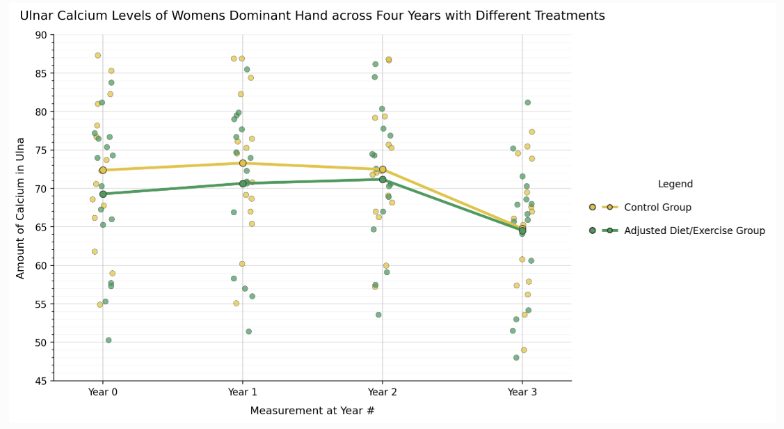
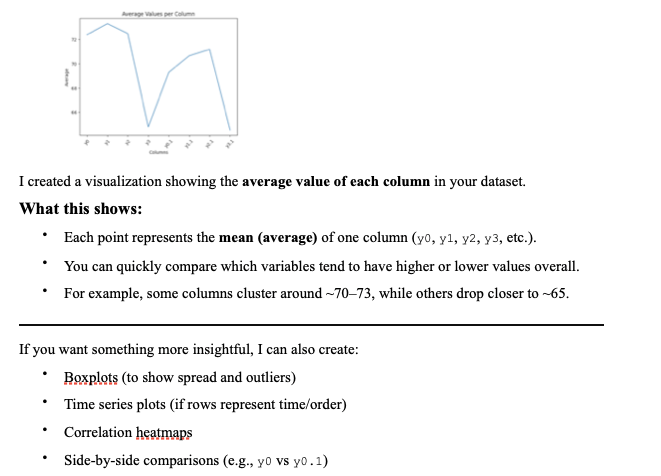
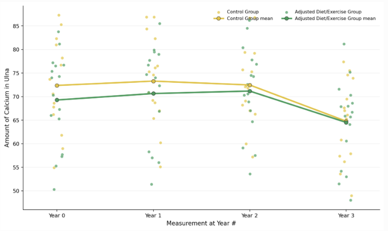

```{r}
#### Packages Needed ----
# install.packages(tidyverse)
# install.packages(knitr)
# install.packages(kableExtra)
```
# --- Diamonds Measurement Analysis

## --- Context
  @tbl-ColorQual-by-Length, @tbl-ColorQual-by-Width, and @tbl-ColorQual-by-Height each summarize different measurements of diamonds taken from the diamonds dataset in RStudio. Each of these tables focus on a specific dimension of measurement - length, width, and height, respectively - and give summary stats of these diamonds when grouped by color quality, those stats including quintile calculations, median, minimum, maximum, mean, standard deviation, and total diamond count.
  
  The Diamonds dataset itself is a synthetic dataset included with RStudio that depicts over 53000 diamonds with multiple different attributes: color quality, diamond clarity, cut quality, cost, measurements, weight, depth, and table. In addition, color quality is defined by a scale of D (best/colorless) to J (worst/containing a yellow/brown tint)

## --- Figures
```{r}
#| label: tbl-ColorQual-by-Length
#| tbl-cap: "Summary Statistics of Diamond Length (in mm) by Color Quality"
#| tbl-pos: "H"
#| fig-alt:
#|  - "Table of summary statistics of diamond length, grouped by their color quality."

#### Table 1 - Length Statistics of Diamonds by Color Quality ----
library(tidyverse)
library(knitr)
library(kableExtra)
data(diamonds)

# Re-arrange and summarize the data
diamondSumX <- diamonds |>
  select(x, color) |>
  group_by(color) |> #Group everything by X-measurement (length by desc.)
  filter_out(x == 0) |>
  summarize( #Procure a summary
    `# OF DIAS` = n(),
    MIN = min(x),
    `1Q` = quantile(x, probs = 0.2),
    `2Q` = quantile(x, probs = 0.4),
    MEDIAN = median(x),
    `3Q` = quantile(x, probs = 0.6),
    `4Q` = quantile(x, probs = 0.8),
    MAX = max(x),
    MEAN = mean(x),
    `STD` = sd(x)
  ) |>
  mutate(across(.cols = -color, .fns = ~round(.x, digits = 2))) |>
  rename("Color Quality" = color)
  
#Create a view-able table with Latex format to collapse within YAML page bounds 
diamondSumXView <- diamondSumX |>
  kable(
    align = "ccccccccccc",
    format = "latex",
    position = "H"
  )
diamondSumXView |>
  kable_styling(
    latex_options = "scale_down",
     font_size = 9, 
     full_width = FALSE,
  ) |>
  # Increase visual contrasts
   row_spec(0, bold = TRUE, background = "#B3B3B3") |>
   column_spec(c(1,2), bold = TRUE, background = "#B3B3B3" ) |>
   add_footnote(label = 
            c("QN represents Quintiles and STD represents Standard Deviation.",
            "color quality ranges from best(D) to worst(J)"))
```

```{r}
#| label: tbl-ColorQual-by-Width
#| tbl-cap: "Summary Statistics of Diamond Width (in mm) by Color Quality"
#| tbl-pos: "H"
#| fig-alt:
#|   - "Table of summary statistics of diamond width, grouped by their color quality."
#|        

#### Table 2 - Width Statistics of Diamonds by Color Quality ----
library(tidyverse)
library(knitr)
library(kableExtra)
data(diamonds)

# Re-arrange and summarize the data
diamondSumY <- diamonds |>
  select(y, color) |> 
  group_by(color) |> #Group everything by Y-measurement (length by desc.) 
  filter_out (y == 0) |>
  summarize( #Procure a summary.
    `# OF DIAS` = n(),
    MIN = min(y),
    `1Q` = quantile(y, probs = 0.2),
    `2Q` = quantile(y, probs = 0.4),
    MEDIAN = median(y),
    `3Q` = quantile(y, probs = 0.6),
    `4Q` = quantile(y, probs = 0.8),
    MAX = max(y),
    MEAN = mean(y),
    `STD` = sd(y)
  ) |>
  mutate(across(.cols = -color, .fns = ~round(.x, digits = 2) )) |>
  rename("Color Quality" = color)

#Create a view-able table with Latex formato to collapse within YAML page bounds 
diamondSumYView <- diamondSumY |>
  kable(
    align = "ccccccccccc",
    format = "latex",
    position = "H"
  )
diamondSumYView |>
   kable_styling(
     latex_options = "scale_down",
     font_size = 9, 
     full_width = FALSE,
     ) |>
   # Increase visual contrasts
   row_spec(0, bold = TRUE, background = "#B3B3B3") |>
   column_spec(c(1,2), bold = TRUE, background = "#B3B3B3" ) |>
   add_footnote(label = 
            c("QN represents Quintiles and STD represents Standard Deviation.",
            "color quality ranges from best(D) to worst(J)"))
```

```{r}
#| label: tbl-ColorQual-by-Height
#| tbl-cap: "Summary Statistics of Diamond Height (in mm) by Color Quality"
#| tbl-pos: "H"
#| fig-alt:
#|   - "Table of summary statistics of diamond height, grouped by their color quality."

#### Table 3 - Length Statistics of Diamonds by Color Quality ----

library(tidyverse)
library(knitr)
library(kableExtra)
data(diamonds)

# Re-arrange and summarize the data
diamondSumZ <- diamonds |>
  select(z, color) |> 
  group_by(color) |> #Group everything by Z-measurement (length by desc.) 
  filter_out (z == 0) |>
  summarize( #Procure a summary.
    `# OF DIAS` = n(),
    MIN = min(z),
    `1Q` = quantile(z, probs = 0.2),
    `2Q` = quantile(z, probs = 0.4),
    MEDIAN = median(z),
    `3Q` = quantile(z, probs = 0.6),
    `4Q` = quantile(z, probs = 0.8),
    MAX = max(z),
    MEAN = mean(z),
    `STD` = sd(z)
  ) |>
  mutate(across(.cols = -color, .fns = ~round(.x, digits = 2) )) |>
  rename("Color Quality" = color)

#Create a view-able table with Latex formato to collapse within YAML page bounds 
diamondSumZView <- diamondSumZ |>
  kable(
    align = "ccccccccccc",
    format = "latex",
    position = "H"
  )
diamondSumZView |>
   kable_styling(
     latex_options = "scale_down",
     font_size = 9, 
     full_width = FALSE,
     ) |>
   # Increase visual contrasts
   row_spec(0, bold = TRUE, background = "#B3B3B3") |>
   column_spec(c(1,2), bold = TRUE, background = "#B3B3B3" ) |>
   add_footnote(label = 
            c("QN represents Quintiles and STD represents Standard Deviation.",
            "color quality ranges from best(D) to worst(J)"))
```
## --- Analysis and Potential Conclusions
Across all three of these tables, we can understand some of the general context and patterns behind the data. For one, the color quality follows a bell-curve trend of sorts where there is a larger demographic of middle-quality diamonds than higher or lower quality ones(though it doesn't scale like a true bell-curve structure and there are far less lower quality color diamonds than high quality color diamonds). 

The more important trend to be drawn, though, is that the diamonds almost always get bigger as the color quality decreases. @tbl-ColorQual-by-Length, @tbl-ColorQual-by-Width, and @tbl-ColorQual-by-Height (to a lesser extent) all display a very general trend of smaller measurements for more quality colors and larger measurements for less quality colors. It is fair from this that we can infer that diamonds are expected to be bigger across the board when they are worse in quality.

In addition, we can also note that diamonds are more concentrated on lower values the higher the quality of the color is and more concetrated on higher values the lower the quality of the color is (take @tbl-ColorQual-by-Length for example, where we can see that Color Quality D has a smaller gap between Quintile 1 and Median (0.75mm diff) than it does Quintile 4 and Median (1.12mm diff) but Color Quality J has a smaller gap between Quintile 4 and Median (0.89mm diff) than Quintile 1 and Median (1.3mm diff)). Alongside the above point, this could point to a difference in size expectations between better and worse colored diamonds.


When it comes to comparing these tables separately, we find that @tbl-ColorQual-by-Height differs by @tbl-ColorQual-by-Length and @tbl-ColorQual-by-Width substantially when it comes to minor patterns and general numbers. Barring a few extremely stray outliers in the Width summary, the numbers between @tbl-ColorQual-by-Length and @tbl-ColorQual-by-Width are extremely similar. @tbl-ColorQual-by-Height is a bit different from the rest, with smaller values across the board.


# --- Monte Carlo Integration Analysis
## --- Context

@fig-MonteCarlo-over-Weibull is a representation of Monte Carlo Integration (an integration method that uses randomly sampled points instead of calculus in order to estimate the area beneath a curve) on the Weibull function, which follows the equation shown below:

$f(x)=\frac{k}{\lambda}(\frac{x}{\lambda})^{k-1}e^{-(\frac{x}{\lambda})^k}$ 
 
where the scale parameter ($\lambda$) is equal to 1 and the shape parameter ($k$) is equal to 1.5.

The bound of integration is $0<=x<=4$ and the range of Y points generated is $0<=y<=0.8$.
 
The entire figure contains 4 sub-figures, each of which represents a different sample size - 10, 100, 1000, and 10000. The green curve represents the function.

## --- Visualization of 1 Random Sample Set

```{r}
#| label: fig-MonteCarlo-over-Weibull
#| fig-cap: "Monte Carlo Integration over Weibull Distribution"
#| fig-subcap: 
#|  - "Sample Size $n = 10$"
#|  - "Sample Size $n = 100$"
#|  - "Sample Size $n = 1000$"
#|  - "Sample Size $n = 10000$"
#| fig-pos: "H"
#| layout-ncol: 2

#### Table 1 - Full Monte Carlo integration + plots ----

library(tidyverse)
library(tidyverse)

# Entire function for Monte Carlo Generation on the set function.
MonteCarloGeneration = 
  function(nSample, xLowBound, yLowBound, xHiBound, yHiBound){
  # Sample data points
  results <- replicate(
    n = nSample,
    expr = c(runif(1, xLowBound, xHiBound), runif(1, yLowBound, yHiBound))
  )
  
  results <- results |>
    t() |>
    as.data.frame() |>
    rename(x = V1, y = V2)
  frame <- list()
  frame$data <- results
  
  # check for if points are under Weibull graph or not
  frame$data <- frame$data |>
    mutate(
      da_weibull = dweibull(x, shape = 1.5, scale = 1),
      `Part of Integral` = if_else(
        da_weibull >= y,
        "TRUE",
        "FALSE")
    )
  
  # calculate area given bounds
  frame$area <- frame$data |>
    filter(`Part of Integral` == TRUE) |>
    summarize(n = n())
  
  frame$area <- (frame$area /nSample) * 
                (xHiBound - xLowBound) *
                (yHiBound - yLowBound)
  
  
  #ggplot
  frame$plot <- ggplot(
    data = frame$data,
    mapping = aes(
      x = x,
      y = y,
      color = `Part of Integral`
    )
  ) +
    geom_point() +
    scale_color_manual(
      values = c(
        "#911406",
        "#027315")
    ) +
    stat_function(
      fun = dweibull,
      args = list(shape = 1.5, scale = 1),
      xlim = c(xLowBound, xHiBound)
    ) +
    labs(
      caption = paste("The integral was estimated to equal", frame$area)) +
    theme_bw()
  
  return(frame)
}

# Individual vis.
frame10 <- MonteCarloGeneration(10, 0, 0, 4, 0.8)
frame100 <- MonteCarloGeneration(100, 0, 0, 4, 0.8)
frame1000 <- MonteCarloGeneration(1000, 0, 0, 4, 0.8)
frame10000 <- MonteCarloGeneration(10000, 0, 0, 4, 0.8)

frame10$plot
frame100$plot
frame1000$plot
frame10000$plot

```  

## --- Analysis and Potential Conclusions

We can visually see what the Weibull function looks like in practice with the aforementioned parameters, looking like a left-skewed curve of sorts. We can also visually see the concept behind how points represent the attempted accuracy of the estimation. With multiple runs of the code for the random point generation (shown in Code Appendix - Figure 1), we see that the samples of n = 10 and n = 100 are incredibly volatile and appear less representative of the actual area beneath the graph, while samples of n = 1000 and n = 10000 begin to start looking more representative of the area visually, as there is a lot less white space.

With multiple sets of generations, we can also see the effect that the number of points generated has on the actual value of the integral. Underneath each individual graph is the estimation of the integral value (calculated by taking the ratio of # of points within the integral/total # of points and multiplying it by the area of where points can be generated), and when looking at the values, we see that the values from n = 10 often land between 0.64 and 1.28, a pretty wide and inconclusive range, but once we reach n = 10000 we get a much more conclusive range between 0.98 and 1.02, meaning that we can eke the estimated value out to roughly 1. Even without knowledge of the actual integral value, the process itself appears like it is capable of producing a plenty accurate estimation.


# - B1G TEN LOVE DATA 

## - Context

For the Big Ten Love Data competition, I created the below barplot on the win and losses of all of the NCAA Women's Basketball Teams from the Big Ten alliance (B1G) against teams from other alliances across from a time range of 2006 to 2026.

## - Visualization of B1G vs Non-B1G

```{r}
#| label: fig-B1TT-NcaaB1gWinsByYear
#| fig-cap: "Wins and Losses of B1G NCAA Women's Basketball Teams from 2006 to 2026"
#| fig-pos: "H"
#### Figure 2 - B1G Love Data Viz ----

library(tidyverse)
library(rvest)

TeamConf <- read_csv( 
    file = "teams.csv",
    col_select = c(team, conference_short_name)
    )
GameScore <- read_csv(
    file = "team_box.csv",
    col_select = c(season, team_location, team_winner, opponent_team_location)
  )


TeamConf <- as.data.frame(TeamConf) |>
    mutate (conference_short_name = if_else(
      conference_short_name == "Big Ten",
      "B1G",
      "Other Conferences"
    )) 
    
    # Mutate a column to account for late additions into the B1G conference. 
    #If the team was in B1G before 2006, start is 0. 
TeamConf <- TeamConf |> 
    mutate (year_existed = case_when(
      grepl("Washington|UCLA|USC|Oregon", team) ~ 2024,
      grepl("Rutgers|Maryland", team) ~ 2014,
      grepl("Nebraska", team) ~ 2011,
      .default = 0 ) )
          
    

# Wrangle dataset to remove unneeded games 
# and account for new entries into the Big Ten.
GameSet <- as.data.frame(GameScore) |>
    # Classify the teams by their conference/time joined (if relevant)
    left_join(
      y = TeamConf,
      by = c("team_location" = "team")
    ) |>
    left_join(
      y = TeamConf,
      by = c("opponent_team_location" = "team")
    ) |>
    rename(
      team_conference = conference_short_name.x,
      team_when_b1g = year_existed.x,
      opponent_conference = conference_short_name.y,
      opponent_when_b1g = year_existed.y
    ) |>
    
    # Handle all relevant NA cases by classifying them as Other Conferences 
    #(if the school no longer exists as of 2026/7, 
    #as they were never part of the B1G anyways) 
  
    mutate(
      team_conference = replace_na(team_conference, "Other Conferences"),
      opponent_conference = replace_na(opponent_conference, "Other Conferences")
    ) |>
    # Check for B1G games with B1G classified teams 
    #that werent B1G before the game's season.
    mutate(
      team_conference= if_else(
        team_conference == "B1G" & season < team_when_b1g,
        "Other Conferences",
        team_conference
      ),
      opponent_conference = if_else(
        opponent_conference == "B1G" & season < opponent_when_b1g,
        "Other Conferences",
        opponent_conference
      ),
    ) |>
    # Remove all B1G vs B1G, Other vs Other, 
    # and (since there are 2 copies of each game) extra copies.
    filter(
      team_conference == "B1G" &
      opponent_conference == "Other Conferences"
    )

# Summarize the Data into W-L records by year 
GameSum <- GameSet |>
      group_by(season, team_winner) |>
      summarize(n = n()) |>
      mutate(
        team_winner= if_else(team_winner == TRUE,"Wins","Losses"),
        season_unique = paste0("'", (season - 2000)), # visual reform for compactness
        season = factor(x = season_unique, levels = unique(season_unique))
      ) 

# ggplot a double-grouped barplot
ggplot(
  data = GameSum,
  mapping = aes(
    x = factor(season),
    y = n,
    fill = team_winner
  )
) +
  geom_bar(
    stat = "identity",
    position = "dodge"
  ) +
  labs(
    x = "Year of Season",
    y = "Number of Games Won/Lost",
    fill = "Game Results",
    caption = "Source: ESPN Women's College Basketball Team Scores
              * Nebraska joined B1G 2011. 
              * Maryland and Rutgers joined B1G in 2014. 
              * Oregon/UCLA/USC/Washington joined B1G in 2024."
              
  ) +
  scale_y_continuous(
    minor_breaks = seq(0,250, 10)
  ) +
  theme_bw()
```
 
 
## - Analysis and Potential Conclusions
Immediately upon looking at the data and checking the win to loss charts, something is visually clear - the B1G are a historically strong alliance in the Women's Basketball field. From the visibly recorded data, Women's Basketball teams from the Big Ten almost always have about at least double the victories than they do losses against other conferences, with the most visible exception being in 2017, where they still retained about 60% more wins than losses. 

Another thing that is interesting to note is that the Big Ten seems to have actually gotten stronger in the most recent years (as of writing this analysis), as the ratio of wins to losses consistently hovered around 2-2.5:1 from 2014 to 2024, but reached record highs in 2025 and 2026, with almost 200 wins and under 50 losses in both years, bordering on a 3.5-4:1 win/loss ratio. 

Something important to potentially be considered is the lack of information in the document. The data provided appears suspiciously incomplete, with very little data recorded from the period of 2006-2013, and the graph all of a sudden begins looking normal in 2014. Given nothing historical happened then, outside of Maryland and Rutgers joining the Big Ten, there could be some doubt thrown in on the quality of the dataset, as well as a lack of clear understanding of what happened during that time frame. However, the rest of the trends from 2014-2026 is clear, and is even minimally reflected in the few games of the early time frame, showing that there is potential that the Big Ten were just as dominant in their wins then as they are now.
 


# --- Generative AI - Presentative Exhibit

## -- General Context Behind Data
These two sections below represent two different kinds of prompts into AI over this following context.

## -- Generic Interpretation by AI
First, we will put the CSV file with a generic prompt saying to "create a data visualization".

{#fig-GenericAtt}


And while @fig-GenericAtt is a tangible visualization, it is messy and provides absolutely no context whatsoever.

The graph itself could benefit from some ticks and subticks in order for the exact values to be more easily identifable, because even though we can estimate the values very generally, we can absolutely get a more specific visual. The far more pressing issue, however, is that the captions provide absolutely no information about the actual context behind the visualization. The axes are labelled generically, just saying "Columns" and "Average", providing none of the context we need in order to understand that it's supposed to reflect "Year" and "Calcium Levels", much less the entire story behind the data about control groups, where the calcium was measured, etc.

In addition, the data file itself happened to not be tidy, and that was ultimately not fixed in the data visualization, as evident by the duplicate y(n) columns.


## -- Specific Interpretation
OpenAI ChatGPT with a generic prompt failed to give any sort of interpretable visualization, but we can try giving it a response with a much more tailored prompt, complete with the ways the data itself is meant to be tidied, some of the context needed for a reader to understand what is going on, and how the data visualization should be visualized.

With that being said, we can split a plan into a goals, needs, and steps system and send it all over in a prompt. Upon sending this completed plan:
-- GOALS \

Create a data visualization to show the difference in amount of calcium in the ulna of a woman's dominant hand between people who live as they normally do for 4 years and people who were treated with a specific diet/exercise program for 4 years \

--NEEDS \

calcium.csv, OpenAI (this isn't self coded so needs are different) \

--VERBS \

classify, summarize, create, graph, add \

--FOLLOW THE ACTIONS BELOW THIS LINE \

On calcium.csv an additional classification to each columns with the ones on the left (columns 1-4) representing Control Group and the columns on the right(columns 5-8) as Adjusted Diet/Exercise Group \
On calcium.csv together the duplicated columns (there should be two each of y0, y1, y2, and y3) and set the additional classification in Step 1 as an extra variable
On calcium.csv all of the y(n) column names as Year (n) instead.\
Duplicate this dataset. Do not visualize either dataset. \
On the duplicated dataset, group the data by both the Year (n) classification and the Group classification (there should be a total of 8 total groups) \
For each group, find the mean (named as average) Make sure to maintain the classifications they are grouped by. \
Create a XY data plot with X being the Year classification, Y being the actual numerical values themselves.  \
Add a color legend where Control Group is Yellow and Adjusted Diet/Exercise Group is Green. \
Insert both the individual numerical values (as points) from the first dataset and the means (as a line) from the second dataset. Make sure they are both colored by their Group classification. \
Add captions to X and Y, with Y being "Amount of Calcium in Ulna" and X being "Measurement at Year #" \
Add vertical plot lines to each of the Year numbers in the X, and add measurement lines of gap 5 (from 45-90) and sub-measurement lines of gap 1 (from 45-90). \
Move the Legend to the right of the data plot and move everything into one column, with a header above the legend called "Legend". \
Add a title saying "Ulnar Calcium Levels of Womens Dominant Hand across Four Years with Different Treatments" \
Show me only the final completed data plot \

we would receive this:



Upon seeing this data visualization, we can immediately see significant improvement. For one, there is proper context behind the data now. Without the added context written above, we can see that this data is above the ulnar calcuim levels of women's dominant hand across 4 years given either a control condition or an adjusted data/exercise condition. We can see that there was a measurement of calcium for every year, and we can reasonably assume the meaning of the individual data themselves as well as the connective lines (though that technically shouldn't be neccessary.)
There are couple deficiencies in this visualization, such as not including units of the calcium measurement, not explaining what "control group" means, and not explicitly stating the dots vs the connected line-dots. However, the overall difference in explicitly stating what you want from GenAI and giving GenAI some crucial context in the process is clearly extremely helpful, as the data values themselves are much more readable than last due to the frame being polished with tick lines being properly added, and we can actually identify the trend we want to be able to find in the data as a result of the data being tidied, that being the difference between the groups.


# --- Student/Author Reflection

I believe that across the course of this class I've learned a lot more about what working with data is actually about compared to what I would have after taking the DS200/MATH220 equivalents in High School.

I was under the impression that all of the work was figuring out what set data meant, but I was never under the impression that a lot of the work can come down to how you clean the data and how you manipulate it to show what you want and give you the context you want. This coding style is also incredibly different from the other more "conventional" beginner styles that work with programming languages like Python, Java, HTML, and CSS, as the problem tackling is way different since it isn't nearly as linear, which I feel is evidenced by how necessary redoing plans and going backwards on code after discovering new issues with data that don't present themselves upfront, which I don't find myself doing nearly as much in other programming languages like Python.

As a result, while I think I have struggled for almost the entire course on grasping this style of programming, some moments more than others, especially given I learn very heavily from frequent examples and rigid input, I think I have been able to get far better at my problem-solving and programming creativity, as evidenced in 3.4 where there were 3 different data visualizations where we had to make from scratch with no instructions and raw data (which I unironically had a lot of fun coding and slowly watching my data re-shape itself into something tangible, compared to earlier where I would often be piss stressed at how little progress I could make across hours of work on a single chunk of code).

I also have been improving at researching ideas for solutions and working with code limitations, as given this course provides very little besides general conventions and almost never goes into actual coding outside of the one Hypoxia wrangling (which I actually did not understand at all in the time that it was done) I have been forced to use official sets of documentation, read off of example code to implement in my own code, document everything I could find even a remote clue about, and work around limitations that I cannot find in reasonable time, which I really think has grown me as a programmer in terms of mindset and not just technical knowledge, even if the process itself hasn't been easy or likeable.





# -- Generative AI - Documentation of Usage

-----On 3/31/2026,  ChatGPT (running GPT-5.3) was provided the calcium.csv file and this prompt: \
         Create a data visualization for these data \
-----and received this response: \
          
-----On 3/31/2026, ChatGPT (running GPT-5.3) was provided this prompt:\
          What is your version information?\

----- and received this response:\
          You’re chatting with ChatGPT based on the GPT-5.3 architecture.\
          Key details:\
          Model: GPT-5.3\
          Knowledge cutoff: August 2025\
          Current date (system): March 31, 2026\
          If you need more technical details (capabilities, differences vs GPT-4/5, etc.), just let me know 👍\


-----On 11/20/2026, I provided ChatGPT (running GPT-6) the calcium.csv file and this prompt: \
          -- GOALS\
          Create a data visualization to show the difference in amount of calcium in the ulna of a woman's dominant hand between people who live as they normally do for 4              years and people who were treated with a specific diet/exercise program for 4 years\
          --NEEDS\
          calcium.csv, OpenAI (this isn't self coded so needs are different)\
          --VERBS\
          classify, summarize, create, graph, add\
          --FOLLOW THE ACTIONS BELOW THIS LINE\
          On calcium.csv an additional classification to each columns with the ones on the left (columns 1-4) representing Control Group and the columns on the right(columns           5-8) as Adjusted Diet/Exercise Group \
          On calcium.csv together the duplicated columns (there should be two each of y0, y1, y2, and y3) and set the additional classification in Step 1 as an extra                   variable\
          On calcium.csv all of the y(n) column names as Year (n) instead.\
          Duplicate this dataset. Do not visualize either dataset.\
          On the duplicated dataset, group the data by both the Year (n) classification and the Group classification (there should be a total of 8 total groups)\
          For each group, find the mean. Make sure to maintain the classifications they are grouped by\
          Create a XY data plot with X being the Year classification, Y being the actual numerical values themselves. \
          Add a color legend where Control Group is Yellow and Adjusted Diet/Exercise Group is Green.\
          Insert both the individual numerical values (as points) from the first dataset and the means (as a line) from the second dataset. Make sure they are both colored            by their Group classification.\
          Add captions to X and Y, with Y being "Amount of Calcium in Ulna" and X being "Measurement at Year #"\
          Show me only the final completed data plot\


-----and received this visualization:



-----On 11/20/2026, I provided ChatGPT (running GPT-6) this message:\


-- GOALS \
Create a data visualization to show the difference in amount of calcium in the ulna of a woman's dominant hand between people who live as they normally do for 4 years and people who were treated with a specific diet/exercise program for 4 years \
--NEEDS \
calcium.csv, OpenAI (this isn't self coded so needs are different) \
--VERBS \
classify, summarize, create, graph, add \
--FOLLOW THE ACTIONS BELOW THIS LINE \
On calcium.csv an additional classification to each columns with the ones on the left (columns 1-4) representing Control Group and the columns on the right(columns 5-8) as Adjusted Diet/Exercise Group \
On calcium.csv together the duplicated columns (there should be two each of y0, y1, y2, and y3) and set the additional classification in Step 1 as an extra variable
On calcium.csv all of the y(n) column names as Year (n) instead.\
Duplicate this dataset. Do not visualize either dataset. \
On the duplicated dataset, group the data by both the Year (n) classification and the Group classification (there should be a total of 8 total groups) \
For each group, find the mean (named as average) Make sure to maintain the classifications they are grouped by. \
Create a XY data plot with X being the Year classification, Y being the actual numerical values themselves.  \
Add a color legend where Control Group is Yellow and Adjusted Diet/Exercise Group is Green. \
Insert both the individual numerical values (as points) from the first dataset and the means (as a line) from the second dataset. Make sure they are both colored by their Group classification. \
Add captions to X and Y, with Y being "Amount of Calcium in Ulna" and X being "Measurement at Year #" \
Add vertical plot lines to each of the Year numbers in the X, and add measurement lines of gap 5 (from 45-90) and sub-measurement lines of gap 1 (from 45-90). \
Move the Legend to the right of the data plot and move everything into one column, with a header above the legend called "Legend". \
Add a title saying "Ulnar Calcium Levels of Womens Dominant Hand across Four Years with Different Treatments" \
Show me only the final completed data plot \

----- and received this visualization:


-----On 11/20/2026, I provided ChatGPT (running GPT-6) this message: \
    Give me the Version of this chat. \

-----and received this response: \
      This chat is powered by GPT-6 (OpenAI).\




# -- Code Appendix

```{r}
#| label: codeAppend
#| ref-label: !expr knitr::all_labels()
#| echo: true
#| eval: false

```
